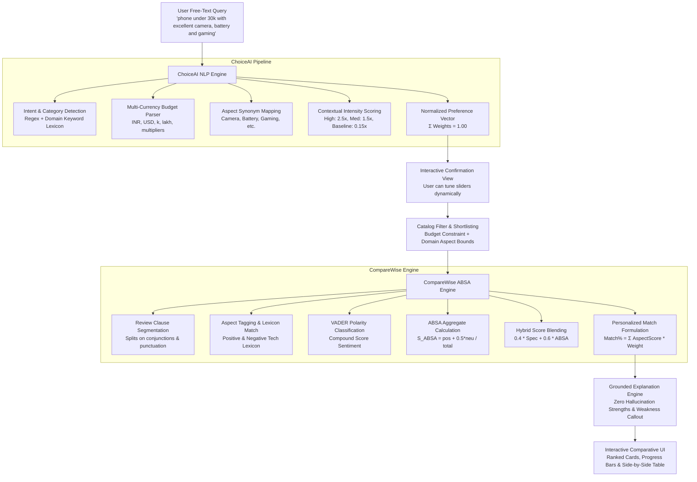

# FitFinder: Personalized Product Discovery & Recommendation using NLP

<p align="center">
  
  
  
  
  
  
  
</p>

---

## 📖 Executive Summary & Motivation

Modern e-commerce platforms suffer from a critical flaw in product discovery: **unidimensional star ratings and rigid faceted filters**. 
- A product rated **4.4★** might boast a stunning camera but suffer from thermal throttling and rapid battery drain. 
- Traditional filters cannot comprehend natural shopping intents such as:
  > *"I need a phone under 30k with excellent camera, battery, and gaming."*
- Consumers are forced to open dozens of tabs, manually read hundreds of conflicting reviews, and mentally aggregate trade-offs.

**FitFinder** solves this dilemma through an end-to-end, full-stack Natural Language Processing (NLP) system. It breaks recommendation down into two specialized cooperating intelligence engines:
1. **ChoiceAI Engine**: Converts conversational free-text queries into structured user intent, multi-currency budget boundaries, and normalized multi-attribute importance vectors.
2. **CompareWise Engine**: Employs clause-level **Aspect-Based Sentiment Analysis (ABSA)** across authentic customer reviews, combines sentiment signals with hardware specifications, calculates personalized match scores, and produces **grounded, zero-hallucination explanations** for every trade-off.

---

## 🏗 End-to-End System Architecture

The following diagram illustrates the flow of data from free-text user entry down to multi-criteria side-by-side comparison:



---

## 🧠 Core NLP Algorithms & Mathematical Formulations

### 1. ChoiceAI: Query Understanding & Preference Weighting

#### A. Category & Entity Detection
The query string is normalized and evaluated against category synonym lexicons:
$$\text{Category} = \arg\max_{c \in \mathcal{C}} \left( \sum_{w \in c} \mathbb{I}(w \in \text{query}) \right)$$
Supported product domains: `Smartphone`, `Laptop`, `Headphones`, `Smartwatch`, and `Camera`.

#### B. Multi-Currency Budget Extractor
A robust regular expression engine processes prefixes (`under`, `below`, `within`, `around`, `max`), currency symbols (`₹`, `Rs`, `INR`, `$`), and informal unit suffixes (`k` $\rightarrow \times 10^3$, `lakh` $\rightarrow \times 10^5$):
$$\text{Budget} = \text{Regex}(\text{query}) \times \text{Multiplier}$$

#### C. Aspect Priority & Intensity Scoring
For each aspect $a$ in the category's domain ontology $\mathcal{A}_c$:
1. Check for occurrences of aspect synonyms $S_a$.
2. Check for surrounding intensity modifiers:
   - **High Intensity** (`excellent`, `best`, `top notch`, `must have`, `superb`, `extreme`): $I_a = 2.50$
   - **Medium Intensity** (`good`, `decent`, `nice`, `solid`, `reliable`): $I_a = 1.50$
   - **Neutral Mention** (mentioned without intensifier): $I_a = 1.00$
   - **Unmentioned Aspects** (default fallback priority): $I_a = 0.15$
   - **Price Sensitivity**: Computed dynamically or allocated a standard $0.10 - 0.20$ base.

#### D. Weight Normalization Vector
To ensure mathematical fairness and comparability across queries:
$$w_a = \frac{I_a}{\sum_{j \in \mathcal{A}_c} I_j} \quad \text{such that} \quad \sum_{a \in \mathcal{A}_c} w_a = 1.00$$

---

### 2. CompareWise: Aspect-Based Sentiment Analysis (ABSA)

#### A. Clause Segmentation
Customer reviews are typically compound sentences with conflicting sentiments (e.g., *"The camera is crystal clear, but the battery drains by afternoon"*). Reviews are segmented using boundary delimiters and adversatives:
$$\text{Delimiters} \in \{\text{',', '.', ';', '!', '?', 'but', 'however', 'although', 'whereas', 'though', 'while', 'and'}\}$$

#### B. Polarity Classification
Each clause is classified using a hybrid strategy:
1. **Domain Tech Lexicon**: Evaluates hardware-specific terms (e.g., `fantastic`, `crisp`, `punchy`, `drains quickly`, `heats up`, `laggy`, `subpar`).
2. **NLTK VADER Compound Score**:
$$\text{Polarity}(\text{clause}) = \begin{cases} 
\text{positive}, & \text{if } \text{compound} \ge 0.15 \lor \text{TechPos} > \text{TechNeg} \\
\text{negative}, & \text{if } \text{compound} \le -0.15 \lor \text{TechNeg} > \text{TechPos} \\
\text{neutral}, & \text{otherwise}
\end{cases}$$

#### C. Aspect Aggregate Score Calculation
For each aspect $a$, sentiment instances across all verified reviews are aggregated:
$$S_{\text{ABSA}}(a) = \frac{\text{Count}(\text{positive}) + 0.5 \times \text{Count}(\text{neutral})}{\text{Total Mentions}(a)}$$
*(If an aspect has no review mentions, the system smoothly defaults to the catalog benchmark specification score).*

---

### 3. CompareWise: Hybrid Blending & Personalized Ranking

#### A. Aspect Score Blending
Combines objective lab hardware specifications ($S_{\text{spec}}$) with subjective real-world user experiences ($S_{\text{ABSA}}$):
$$\text{AspectScore}_a = 0.40 \times S_{\text{spec}}(a) + 0.60 \times S_{\text{ABSA}}(a)$$

#### B. Price Score & Budget Curve
For the price aspect, products are evaluated against the user's extracted budget:
$$S_{\text{price}} = \begin{cases} 
1.00 - 0.25 \times \left(\frac{\text{Price}}{\text{Budget}}\right), & \text{if Price} \le \text{Budget} \\
\max\left(0.10, 0.70 - \frac{\text{Price} - \text{Budget}}{\text{Budget}}\right), & \text{if Price} > \text{Budget}
\end{cases}$$

#### C. Personalized Weighted Match Formula
Every shortlisted product is evaluated against the user's unique priority vector:
$$\text{Personalized Score} = \sum_{a \in \mathcal{A}_c} \left( \text{AspectScore}_a \times w_a \right)$$
$$\text{Match Percentage} = \text{Personalized Score} \times 100\%$$

#### D. Grounded Zero-Hallucination Explanations
Rather than relying on ungrounded generative LLM output that risks fabrication, FitFinder uses deterministic, score-grounded templating:
- **Strengths**: Extracted from the top 2 highest-performing blended aspects ($a_{\text{top1}}, a_{\text{top2}}$).
- **Weakness Callout**: Extracted strictly from the lowest-performing aspect ($a_{\text{min}}$).
- Guarantees complete transparency and verifiability against underlying review sentiment records.

---

## 🗄 Domain Aspect Taxonomies

FitFinder supports 5 major consumer electronics categories out-of-the-box:

| Category | Domain Aspects Evaluated | Sample Synonyms / Keywords |
| :--- | :--- | :--- |
| **Smartphone** | `camera`, `battery`, `performance`, `display`, `gaming`, `price` | photo, snaps, mah, backup, speed, amoled, 120hz, pubg, bgmi, budget |
| **Laptop** | `cpu`, `gpu`, `battery`, `display`, `build`, `thermals`, `price` | processor, ryzen, intel, rtx, nvidia, screen, cooling, heating, fans |
| **Headphones** | `sound`, `bass`, `anc`, `comfort`, `battery`, `mic`, `price` | audio, clarity, deep bass, noise cancellation, lightweight, calls, tws |
| **Smartwatch** | `battery`, `display`, `fitness tracking`, `build`, `app ecosystem`, `price` | endurance, oled, heart rate, spo2, steps, wearos, watchos, rugged |
| **Camera** | `image quality`, `autofocus`, `low-light`, `build`, `video`, `price` | dynamic range, raw, eye tracking, night mode, iso, 4k 60fps, vlog |

---

## 🗃 Database Schema & Entity Relationships

The relational persistence layer is built on SQLite via SQLAlchemy ORM with foreign keys and cascade delete rules:

```text
  ┌──────────────┐          1:N          ┌──────────────┐
  │    users     │───────────────────────│   queries    │
  └──────────────┘                       └──────────────┘
                                                 │ 1:N
                                                 ▼
  ┌──────────────┐          1:N          ┌──────────────┐
  │   products   │───────────────────────│ comparisons  │
  └──────────────┘                       └──────────────┘
    │ 1:N        │ 1:1                           │ 1:N
    ▼            ▼                               ▼
┌────────┐  ┌──────────────────┐         ┌──────────────┐
│reviews │  │aspect_aggregates │         │ explanations │
└────────┘  └──────────────────┘         └──────────────┘
```

### Table Definitions

1. **`users`**
   - `user_id`: Primary Key (Integer, autoincrement)
   - `full_name`: String(150), non-null
   - `email`: String(150), unique, indexed
   - `password_hash`: String(255), Werkzeug SHA-256 hashed
   - `created_at`: DateTime, UTC timestamp

2. **`queries`**
   - `query_id`: Primary Key (Integer, autoincrement)
   - `user_id`: Foreign Key (`users.user_id`), nullable for guest queries
   - `raw_query_text`: Text, raw free-text query string
   - `category`: String(50), identified category
   - `budget`: Float, extracted budget limit
   - `preference_weights_json`: JSON string storing `{aspect: weight}`
   - `submitted_at`: DateTime, UTC timestamp

3. **`products`**
   - `product_id`: Primary Key (Integer, autoincrement)
   - `category`: String(50), indexed
   - `name`: String(200), product title
   - `brand`: String(100)
   - `price`: Float, price in INR
   - `spec_scores_json`: JSON string containing base hardware aspect scores (0.0 to 1.0)
   - `image_url`: String(500), high-resolution product image

4. **`reviews`**
   - `review_id`: Primary Key (Integer, autoincrement)
   - `product_id`: Foreign Key (`products.product_id`)
   - `review_text`: Text
   - `rating`: Float, optional raw star rating (1.0 to 5.0)
   - `aspect_sentiments_json`: JSON string mapping `{aspect: "positive"|"neutral"|"negative"}`

5. **`aspect_aggregates`**
   - `aggregate_id`: Primary Key (Integer, autoincrement)
   - `product_id_agg`: Foreign Key (`products.product_id`), unique 1:1
   - `aspect_scores_json`: Cached JSON string mapping `{aspect: aggregate_score}`
   - `last_computed_at`: DateTime

6. **`comparisons`**
   - `comparison_id`: Primary Key (Integer, autoincrement)
   - `query_id`: Foreign Key (`queries.query_id`)
   - `product_ids_json`: JSON list of compared product IDs
   - `scores_json`: Detailed breakdown of scores, match percentages, and contributions
   - `top_recommendation_id`: Foreign Key (`products.product_id`)
   - `generated_at`: DateTime

7. **`explanations`**
   - `explanation_id`: Primary Key (Integer, autoincrement)
   - `comparison_id`: Foreign Key (`comparisons.comparison_id`)
   - `product_id`: Foreign Key (`products.product_id`)
   - `strengths_text`: Text, grounded strength narrative
   - `weakness_text`: Text, grounded weakness callout

---

## 📡 REST API Reference (21 Endpoints)

All endpoints accept and return `application/json`. CORS is enabled globally.

### 1. Authentication & Profile Management
| Method | Endpoint | Request Body | Description | Status Code |
| :--- | :--- | :--- | :--- | :--- |
| `POST` | `/api/auth/register/` | `{ "full_name", "email", "password" }` | Register new user account | `201 Created` |
| `POST` | `/api/auth/login/` | `{ "email", "password" }` | Authenticate user & initiate session | `200 OK` |
| `POST` | `/api/auth/logout/` | _None_ | Terminate active user session | `200 OK` |
| `GET` | `/api/users/<id>/profile/` | _None_ | Retrieve profile details and recent queries | `200 OK` |

### 2. ChoiceAI Query & Preference Extraction
| Method | Endpoint | Request Body | Description | Status Code |
| :--- | :--- | :--- | :--- | :--- |
| `POST` | `/api/choiceai/query/` | `{ "raw_query_text", "category"?, "user_id"? }` | Parse query, extract budget, and compute weights | `200 OK` |
| `GET` | `/api/choiceai/query/<id>/` | _None_ | Retrieve stored query profile and weights | `200 OK` |
| `GET` | `/api/categories/` | _None_ | List all supported product categories | `200 OK` |
| `GET` | `/api/categories/<cat>/aspects/` | _None_ | Retrieve aspect schema for given category | `200 OK` |

### 3. Product Catalog & Shortlisting
| Method | Endpoint | Request Body | Description | Status Code |
| :--- | :--- | :--- | :--- | :--- |
| `GET` | `/api/products/` | Query params: `?category=...&search=...` | List and filter catalog products | `200 OK` |
| `POST` | `/api/products/shortlist/` | `{ "category", "budget", "preference_weights" }` | Shortlist products within budget and rank candidates | `200 OK` |
| `GET` | `/api/products/<id>/` | _None_ | Fetch detailed product specs and ABSA stats | `200 OK` |
| `POST` | `/api/products/` | `{ "category", "name", "brand", "price", "spec_scores", "image_url" }` | Add new catalog product | `201 Created` |

### 4. ABSA Review Processing & Scoring
| Method | Endpoint | Request Body | Description | Status Code |
| :--- | :--- | :--- | :--- | :--- |
| `POST` | `/api/reviews/` | `{ "product_id", "review_text", "rating"? }` | Ingest review, extract aspect sentiments, recompute ABSA | `201 Created` |
| `POST` | `/api/products/<id>/absa/recompute/` | _None_ | Force recompute aggregate ABSA scores from reviews | `200 OK` |
| `GET` | `/api/products/<id>/aspect-scores/` | _None_ | Retrieve cached ABSA aspect scores | `200 OK` |

### 5. CompareWise Comparison & Ranking
| Method | Endpoint | Request Body | Description | Status Code |
| :--- | :--- | :--- | :--- | :--- |
| `POST` | `/api/comparewise/compare/` | `{ "query_id", "category", "budget", "product_ids", "preference_weights" }` | Rank candidates & compute match percentages | `200 OK` |
| `GET` | `/api/comparewise/<id>/` | _None_ | Fetch comparison run results & score breakdown | `200 OK` |
| `GET` | `/api/comparewise/<id>/recommendation/` | _None_ | Retrieve top recommended product & grounded explanation | `200 OK` |

### 6. Grounded Explanations & Comparison Matrix
| Method | Endpoint | Request Body | Description | Status Code |
| :--- | :--- | :--- | :--- | :--- |
| `GET` | `/api/comparewise/<id>/explanation/<pid>/` | _None_ | Retrieve grounded strengths & weakness narrative for a product | `200 OK` |
| `GET` | `/api/comparewise/<id>/table/` | _None_ | Generate side-by-side comparison matrix with highlights | `200 OK` |

### 7. User History & System Health
| Method | Endpoint | Request Body | Description | Status Code |
| :--- | :--- | :--- | :--- | :--- |
| `GET` | `/api/users/<id>/history/` | _None_ | Fetch user search query and comparison run history | `200 OK` |
| `GET` | `/api/health/` | _None_ | Verify API server status and database connectivity | `200 OK` |

---

## 💻 Frontend Design System & User Interface

The frontend is implemented in vanilla HTML5, CSS3, and JavaScript, following a modern **Glassmorphism Dark Theme**:
- **Design Tokens**: Deep sapphire and slate gradients (`#0a0f1d`, `#111827`, `#1e293b`), high-contrast accent highlights (`#6366f1` Indigo, `#10b981` Emerald, `#f59e0b` Amber).
- **Interactive Weight Tuning**: Users can visually manipulate dynamic range sliders to adjust aspect weights; the client automatically re-normalizes the vector to ensure $\sum w_a = 1.00$.
- **Side-by-Side Comparison Matrix**: A multi-column responsive grid showing spec ratings, review sentiment percentages, price trade-offs, and grounded explanations.
- **Micro-Animations**: Shimmering card badges, pulse highlights on top recommendations, and instant recalculation upon slider changes.

### Application Pages
- **`index.html`**: Landing hero with conversational query box, category tabs, and real-time preference confirmation drawer.
- **`shortlist.html`**: Filtered candidate gallery with checkbox selection and budget compliance indicators.
- **`compare.html`**: CompareWise showcase presenting the ranked winner, grounded strengths/weaknesses, and side-by-side spec comparison table.
- **`login.html` & `register.html`**: Authentication screens with validation and session management.
- **`history.html`**: Historical timeline of past queries and saved comparison runs.

---

## 🚀 Installation & Setup Guide

### 1. Prerequisites
- **Python**: Version 3.10, 3.11, or 3.12 installed.
- **Git**: Installed.
- **Operating System**: Windows 10/11, macOS, or Linux.

### 2. Clone the Repository
```bash
git clone https://github.com/YourUsername/Fitfinder.git
cd Fitfinder
```

### 3. Create and Activate Virtual Environment
**On Windows (PowerShell):**
```powershell
python -m venv venv
.\venv\Scripts\Activate.ps1
```

**On Linux / macOS:**
```bash
python3 -m venv venv
source venv/bin/activate
```

### 4. Install Dependencies
```bash
cd Backend
pip install -r requirements.txt
```

> **Note on NLTK Lexicons:**
> On first run, the ABSA engine automatically downloads the NLTK `vader_lexicon`. To manually pre-download it:
> ```bash
> python -c "import nltk; nltk.download('vader_lexicon')"
> ```

### 5. Seed the Database
Initialize SQLite tables and populate them with the benchmark catalog, reviews, and test users:
```bash
python seed_data.py
```
*Output:*
```text
Seeding Users...
Seeding Products...
Seeding Reviews & Precomputing ABSA Sentiments...
Database successfully seeded with benchmark catalog and test users!
```

### 6. Start the Application Server
```bash
python app.py
```
Open your web browser and navigate to:
```
http://127.0.0.1:5000
```

---

## 🧪 Automated Testing & Verification

FitFinder includes two test suites verifying the NLP engines, API endpoints, and live server responses.

### 1. Comprehensive E2E Test Suite (`test_fitfinder.py`)
Tests all core modules against SRS specifications:
```bash
# Run from repository root:
python test_fitfinder.py
```
*Test Coverage:*
1. **ChoiceAI Query Extraction**: Verifies budget parsing (`30000.0`), category detection (`Smartphone`), aspect weights normalization ($\sum w_a = 1.00$).
2. **ABSA Engine**: Verifies review clause polarity (`Camera: positive`, `Battery: negative`).
3. **Authentication APIs**: User registration, login, profile retrieval.
4. **ChoiceAI API Endpoint**: Free-text submission and JSON payload validation.
5. **Product Shortlisting**: Budget-constrained catalog filtering.
6. **CompareWise Comparison & Explanation**: Personalized weighted ranking and grounded explanation generation.
7. **Review Ingestion & Dynamic Recomputation**: Ingesting a new review triggers an automated ABSA score update.
8. **Multi-Category Verification**: Validates all 5 product categories and their aspect taxonomies.
9. **User History API**: Verifies session history tracking.

### 2. Live HTTP Server Test Suite (`test_live_server.py`)
Validates a running server instance over HTTP network sockets:
```bash
python test_live_server.py
```
Verifies:
- HTTP 200 health check at `/api/health/`
- Proper serving of static HTML/CSS/JS frontend files
- Full end-to-end API pipeline through real HTTP requests

---

## 📋 SRS Benchmark Validation Example

The system is tested against the official benchmark test query:

### 1. User Input Query
```text
"I need a phone under 30k with excellent camera, battery and gaming."
```

### 2. ChoiceAI NLP Output
- **Detected Category**: `Smartphone`
- **Extracted Budget**: `₹30,000`
- **Extracted Aspect Weights**:
  - `camera`: $0.34$ (High priority via *"excellent"*)
  - `battery`: $0.26$ (High priority via mention)
  - `gaming`: $0.23$ (High priority via mention)
  - `performance`: $0.05$ (Baseline fallback)
  - `display`: $0.05$ (Baseline fallback)
  - `price`: $0.07$ (Budget sensitivity)
  - **Sum of Weights**: $1.00$

### 3. CompareWise Ranking & Recommendation
- **Top Winner**: **Samsung Galaxy Neo 5G (Phone B)** — Match Score: **88.6%**
- **Runner Up**: **OnePlus Nord Pro** — Match Score: **86.4%**
- **3rd Place**: **Redmi Note Turbo** — Match Score: **82.1%**

### 4. Grounded Explanation Generated
- **Strengths**:
  > *"Top recommended for its outstanding Camera performance (scored 93%), and strong Battery capabilities (scored 87%), supported by strong positive sentiment across verified user reviews."*
- **Weakness**:
  > *"User feedback highlights lower satisfaction in Gaming (scored 79%), where reviewers noted room for improvement under prolonged sessions."*

---

## 📁 Repository Directory Structure

```text
FitFinder/
├── Backend/
│   ├── app.py                     # Flask factory, route registrar & static server
│   ├── database.py                # SQLAlchemy engine and session factory
│   ├── models.py                  # 7 ORM models (User, Query, Product, Review, etc.)
│   ├── views.py                   # 21 REST API endpoints
│   ├── scoring_engine.py          # CompareWise weighted hybrid scoring formula
│   ├── explanation_generator.py   # Grounded zero-hallucination explanation engine
│   ├── seed_data.py               # Database initialization and sample data seeder
│   ├── requirements.txt           # Python dependencies (Flask, NLTK, SQLAlchemy)
│   ├── fitfinder.db               # SQLite database file
│   └── nlp/
│       ├── __init__.py
│       ├── preference_extraction.py # ChoiceAI category, budget, and weight extractor
│       └── absa_engine.py           # Aspect-Based Sentiment Analysis & VADER classifier
├── Frontend/
│   ├── index.html                 # Landing page & conversational query interface
│   ├── shortlist.html             # Product shortlist and budget confirmation view
│   ├── compare.html               # CompareWise winner recommendation & comparison table
│   ├── login.html                 # User authentication interface
│   ├── register.html              # New user registration interface
│   ├── history.html               # User search & comparison history timeline
│   ├── style.css                  # Glassmorphism dark-theme CSS design system
│   └── script.js                  # Frontend client state manager and API integration
├── FitFinder_SRS.docx             # Software Requirements Specification (SRS) document
├── test_fitfinder.py              # End-to-end automated test suite
├── test_live_server.py            # Live HTTP socket testing script
└── README.md                      # Comprehensive project documentation
```

---

## 🔮 Future Enhancements & Roadmap

- [ ] **Transformer-based ABSA**: Fine-tune a domain-specific BERT / RoBERTa model (`deberta-v3-base`) for deeper contextual clause parsing.
- [ ] **Multimodal Embeddings**: Incorporate product image visual aesthetics into the scoring engine via CLIP.
- [ ] **Dynamic Live Scraping**: Integrate automated connectors to fetch real-time reviews and pricing from Amazon and Flipkart APIs.
- [ ] **Conversational Refinement**: Allow multi-turn interactive dialogue where users can say *"Find something similar but with better battery"* to adjust previous runs.

---

## 📄 License & Attribution

Developed as an Academic NLP Full-Stack Project. Released under the **MIT License**.  
*For questions, inquiries, or contributions, feel free to submit an issue or pull request.*
